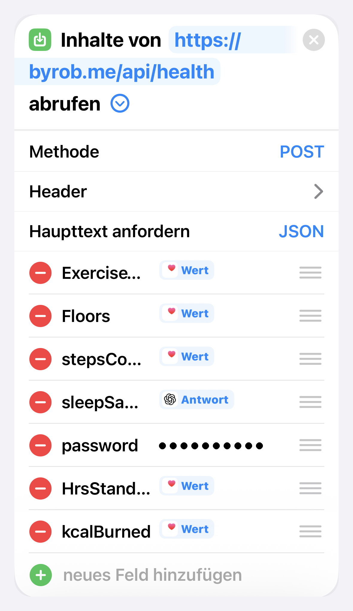
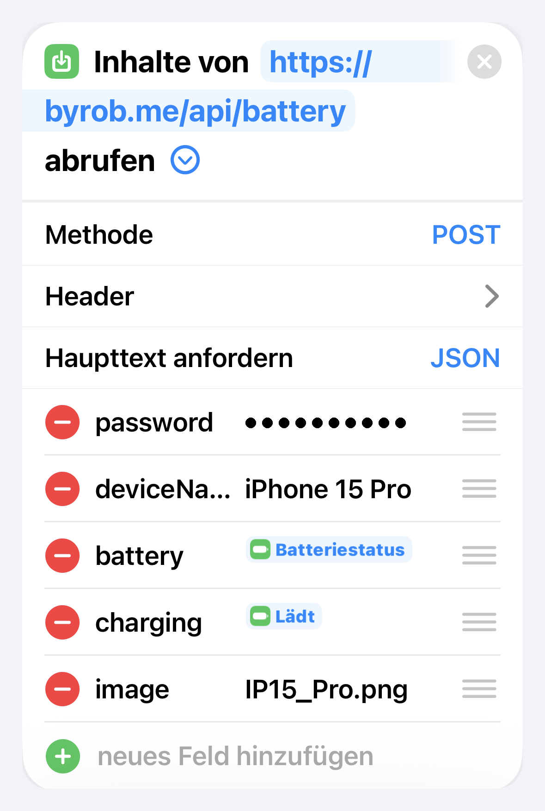
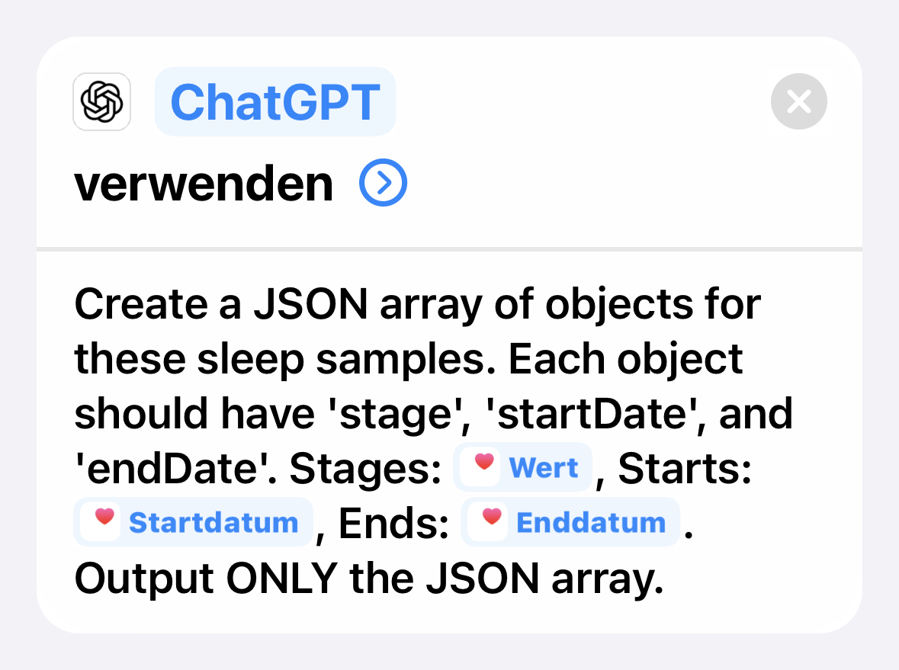

# rob's portfolio!

This is my personal portfolio website, made using [Astro 7](https://astro.build/), which utilizes a brand new and super-fast compiler written in Rust! In addition to that, it uses [Lanyard](https://lanyard.rest/) to fetch my Discord (and therefore also Spotify / Apple Music) stats and [Airtable](https://www.airtable.com/) for my photo gallery & movie ratings. 


## Setting this up & Prerequisites

These three points are the main things that you **definitely** need to change before customizing this site more to yourself. It's also recommended to take a look at other files, such as the `AboutCard`, `ContactCard` or `ProjectsCard` components and changing those as well since they won't be covered in the explanation down below. 

### 1. Lanyard

After cloning the repository, there's some things that we need to setup before all aspects of the site work properly.
First, you need to join the [Lanyard Discord](discord.gg/lanyard) and make sure that activity sharing is enabled for it. Copy your user ID and set it as the value for the `PUBLIC_DISCORD_ID` environment variable.

Your discord user ID will be used inside of the `SpotifyCard` astro component to fetch what you are listening to from Discord. This works with both discord's integrated Spotify Connection aswell as [Cider](https://cider.sh/) (which also has support for Apple Music's animated covers!) if you want to show what you are listening to on Apple Music. You *need* to appear as any kind of "online" on Discord for this to work. 

### 2. Airtable

If you want to have a photo gallery or a list of series/anime/films that you've watched and their ratings on the site, then you'd have to set up [Airtable](https://www.airtable.com/) as well. No need to worry though! This works completely fine with Airtable's free tier and respects it's rate limits.

Start by creating a base with two tables in it, one for photos and one for movies. Now, add some fields to those tables. They have to match exactly though, since they're read directly by the `airtable.ts` lib.

**Photos table:** `Title/Description` (text), `Location` (text), `Category` text, `Camera Settings` (text), `Date Taken` (date) and `Photo` attachment.  
**Movie table:** `Title` (text), `Star Rating` (text), `Type` (text), `Review Notes` (long text), `Date Watched` (date) and `Cover` (attachment).

Only the first attachment of a record is used. If you need to e.g upload multiple photos, then you need to make sure to create multiple records for those.

Once everything's created, grab a [personal acces token](https://airtable.com/create/tokens) with access to your base and put it into `AIRTABLE_TOKEN` variable. Set `AIRTABLE_BASE_ID` to your base's ID which can be found in the URL of your base. Finally, set `AIRTABLE_PHOTO_TABLE` and `AIRTABLE_SERIES_TABLE` to the names of your two tables.

### 3. iOS Devices & Health.

The `DeviceCard` and `TodayStatsCard` components don't fetch anything by themselves. Instead, they're both fed by an iOS Shortcut that POSTs to an API endpoint to the site. Both endpoints are protected by the `BATTERY_KEY` environment variable. So make sure to set that to something safe, like a hashed string. 

This is what the two "Get contents of URL" actions in my Shortcut look like. `password` has to match your `BATTERY_KEY`:

<p align="center">
  
  &nbsp;
  
</p>

Images for your devices are inside of `public/imgs/devices/`. For Apple devices, using the website's photos has worked best for me. They also look the best on the site!

I have one Shortcut for this set up which runs nearly every hour and whenever I open often-used apps such as WhatsApp, Instagram or my Mails. This will make the shortcut run often enough to get accurate device / health details.  
I'm still fine-tuning my shortcut, but once it's done I will share it's link and post it here. Once iOS 27 releases, you might be able to ask Apple's Shortcut Creator AI to do this in a more optimized manner for you as well. I for example had some issues with the sleep data formatting after switching to a FitBit Air, so i'm using ChatGPT inside of the shortcut to format sleep data correctly for me. I tried using Apple's on-device Foundational models, but these are quite slow and often do not give proper output. 

<p align="center">
  
</p>

### 4. Blog posts

Blog posts are just markdown files inside of `src/content/blog/`. Every post needs this frontmatter:

```yaml
---
title: "some title"
description: "short description"
image: "/imgs/blog/cover.png"
tags: ["astro", "webdev"]
date: 2026-08-08
readTime: "4 min"
---
```

## Running it

Running the portfolio is as straightforward as running any other [Astro](https://astro.build/) website.

```sh
npm install
```
and
```sh
npm run dev
```

is enough to get this started. :)

Feel free to fork this and make some changes to customize it!
